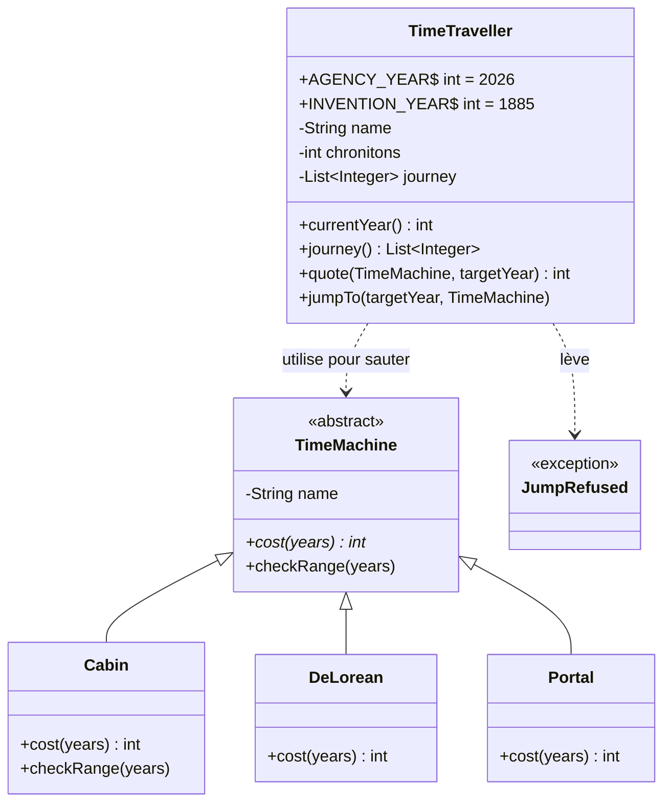

# ChronoTours : correction pas à pas

> **À ne pas distribuer aux étudiants avant la fin de l'exercice.** L'énoncé est dans [`../README.md`](../README.md).

Aucune notion n'était imposée : ce qui suit est **une** solution possible, pas la seule. On suit la même démarche que pour CinéCoda, en version courte.

## 1. Le vocabulaire

On relève les noms (candidats classes ou attributs) et les verbes (candidats méthodes) de l'énoncé.

| Terme métier | Comportement ? | Dans le code |
| --- | --- | --- |
| Voyageur | Saute, demande un devis, tient son carnet | Classe `TimeTraveller` |
| Machine | Calcule le coût d'un saut, vérifie sa portée | Classe abstraite `TimeMachine` |
| Cabine, DeLorean, Portail | Chacune a **sa** règle de coût | `Cabin`, `DeLorean`, `Portal` |
| Chronitons | Une quantité, dépensée à chaque saut | Attribut `chronitons` du voyageur |
| Carnet de voyage | Liste des années, dans l'ordre | Attribut `journey` du voyageur |
| Année de l'agence (2026), année d'invention (1885) | Des constantes | `AGENCY_YEAR`, `INVENTION_YEAR` |
| Saut refusé | Un motif | Exception `JumpRefused` |

| Ce que dit le métier | Qui sait répondre ? | Méthode |
| --- | --- | --- |
| « Combien coûterait ce saut ? » | La machine (elle connaît sa règle de prix) | `machine.cost(years)` |
| « Fais-moi un devis » | Le voyageur (il sait d'où il part), qui demande à la machine | `traveller.quote(machine, year)` |
| « Saute en 1955 » | Le voyageur | `traveller.jumpTo(year, machine)` |
| « Cette machine peut-elle aller si loin ? » | La machine | `machine.checkRange(years)` |
| « Montre-moi le carnet » | Le voyageur | `traveller.journey()`, `traveller.chronitons()` |

## 2. Le diagramme de classes



**Choix à discuter en débrief :**

- **Classe abstraite pour la machine.** Les trois machines partagent un état (leur nom) et un comportement par défaut (portée illimitée), mais chacune **doit** définir son coût. Une interface avec une méthode `default` aurait aussi été valable.
- **Une dépendance, pas une association.** Le voyageur ne **possède** pas de machine : il en **utilise** une le temps d'un saut, passée en paramètre (flèche en pointillés).
- **Pas d'attribut « année actuelle ».** C'est toujours la dernière année du carnet : la stocker à part risquerait de la désynchroniser.
- **Pas de classe `Agence`.** Rien dans le scénario ne la sollicite : deux constantes suffisent. Une classe vide « parce que le mot apparaît » est une erreur fréquente.

## 3. Du scénario au code

On écrit d'abord `Main` en suivant le scénario, comme si les classes existaient, puis on les génère depuis l'IDE (`Alt + Entrée` dans IntelliJ, `Ctrl + .` dans VS Code) :

```java
var marty = new TimeTraveller("Marty", 100);
log.info("Cabine : " + marty.quote(new Cabin(), 1955) + " chronitons");
marty.jumpTo(1955, new DeLorean());
```

### Le polymorphisme : une règle par machine

```java
public class Cabin extends TimeMachine {
    private static final int MAX_RANGE = 100;

    @Override
    public int cost(int years) {
        return years;
    }

    @Override
    public void checkRange(int years) {
        if (years > MAX_RANGE) {
            throw new JumpRefused("la Cabine ne dépasse pas " + MAX_RANGE + " ans de saut (" + years + " demandés)");
        }
    }
}
```

Le voyageur appelle `machine.cost(...)` et `machine.checkRange(...)` **sans savoir quelle machine il utilise** : aucun `if (machine instanceof Cabin)`.

### L'encapsulation : vérifier d'abord, sauter ensuite

```java
public void jumpTo(int targetYear, TimeMachine machine) {
    // Check every rule first: a refused jump changes nothing
    if (targetYear < INVENTION_YEAR) {
        throw new JumpRefused("le voyage dans le temps n'est inventé qu'en " + INVENTION_YEAR);
    }
    if (targetYear != AGENCY_YEAR && journey.contains(targetYear)) {
        throw new JumpRefused(name + " est déjà passé en " + targetYear + ", il risque de se croiser");
    }
    machine.checkRange(distanceTo(targetYear));
    int cost = quote(machine, targetYear);
    if (cost > chronitons) {
        throw new JumpRefused(name + " n'a que " + chronitons + " chronitons, il en faut " + cost);
    }
    // Then travel
    chronitons -= cost;
    journey.add(targetYear);
}
```

- Les chronitons et le carnet n'ont **pas de setter** : ils ne changent que par un saut accepté.
- `journey()` renvoie une **copie non modifiable** (`List.copyOf`) : `Main` ne peut pas réécrire l'histoire.
- `Main` se contente d'appeler `jumpTo` et d'afficher le motif quand il attrape une `JumpRefused`.

## 4. Le test au vert

```bash
cd java
mvn test
```

## 5. Bonus : l'Hyperloop temporel

Pour le coût, une nouvelle classe suffit, sans modifier les classes existantes :

```java
public class TemporalHyperloop extends TimeMachine {
    public TemporalHyperloop() {
        super("Hyperloop");
    }

    @Override
    public int cost(int years) {
        return 50;
    }
}
```

Mais la règle « seulement vers les années bissextiles » dépend de **l'année d'arrivée**, alors que `checkRange` ne reçoit que la **distance**. Il faut donc faire évoluer `TimeMachine`, par exemple avec une méthode `checkDestination(int targetYear)`. C'est une bonne question de débrief : *un modèle n'est ouvert à l'extension que dans les directions qu'on a prévues.*

## Le code source

Le code complet est dans [`../java/src/main/java/chrono`](../java/src/main/java/chrono).
